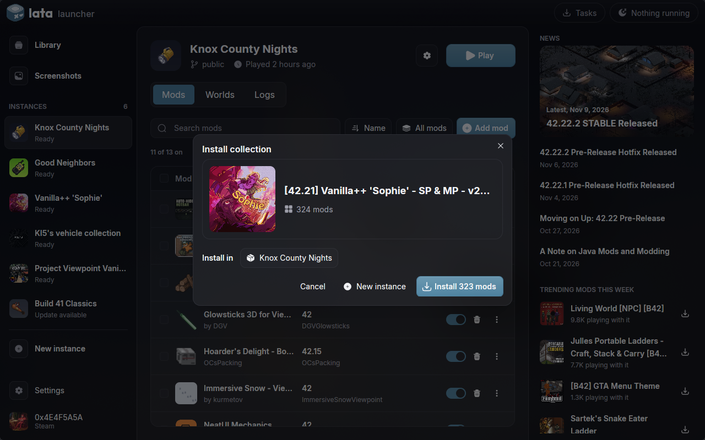
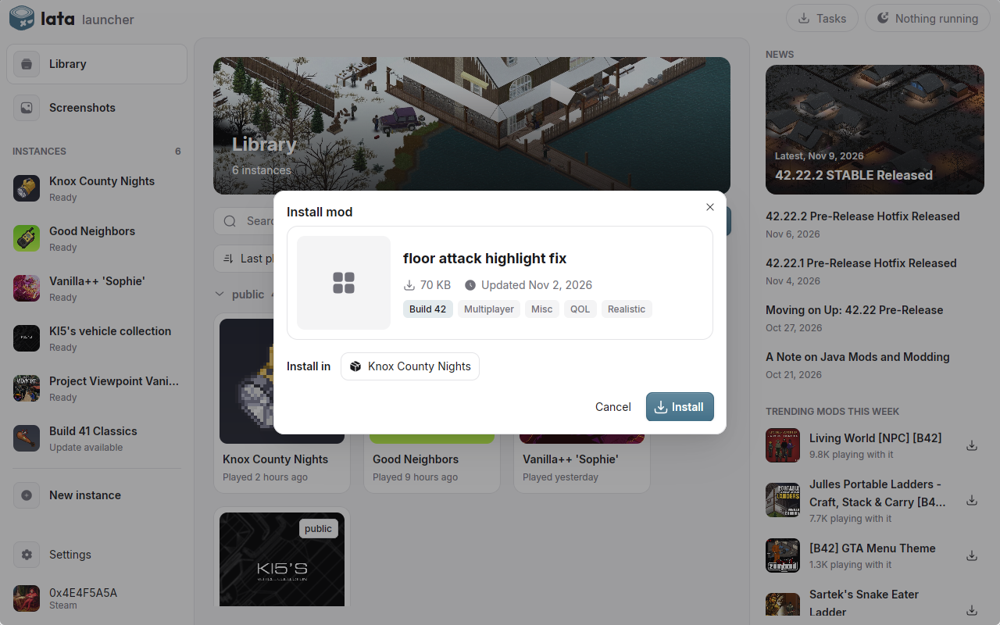

[](https://discord.gg/jeGPaMkDbU)
[](https://github.com/valentin-marquez/lata/releases)
[](https://github.com/valentin-marquez/lata/actions/workflows/ci.yml)
[](LICENSE)

Keep several Project Zomboid installs side by side, each with its own game version, mods and saves.

> Early pre-release. Expect rough edges, and tell us about them on [Discord](https://discord.gg/jeGPaMkDbU).

The game and Workshop mods come straight from Steam, no SteamCMD needed.


## What it does

- Several installs side by side, each on its own Steam branch.
- Mods per instance: add, turn on or off, remove.
- Workshop mods and whole collections installed from a link, with the
  [lata link](extension) browser extension.
- Worlds and live game logs for each instance.
- Light and dark themes.

| | |
|---|---|
|  |  |
|  | |

## Install

Download the file for your system from [Releases](https://github.com/valentin-marquez/lata/releases).
The builds aren't signed yet, so Windows and macOS warn the first time you open lata. `SHA256SUMS`
in each release lists every file's checksum.

### Linux

Unpack it somewhere you own (lata updates itself only where it can write) and run the script inside,
which adds lata to your app menu and makes it open the browser extension's `lata://` links:

```sh
mkdir -p ~/.local/opt && cd ~/.local/opt
tar xzf ~/Downloads/lata-launcher-v*-linux-x86_64.tar.gz
./lata-launcher-v*-linux-x86_64/packaging/linux/install-icons.sh
```

Then open **Lata** from the menu. It needs Vulkan (Mesa or your GPU's driver) and Wayland or X11.
lata updates itself when it starts.

### Windows

Download `lata-launcher-v*-windows-x86_64.exe`, put it in a folder of your own (lata updates itself
only where it can write) and run it. If SmartScreen stops it, choose **More info** and **Run anyway**.
To have the browser extension open lata, turn on **Open links from the browser** in Settings >
Behavior. lata updates itself when it starts.

### macOS (Apple silicon)

Open the `.dmg` and drag **Lata** into Applications. The first time, macOS blocks it: open
System Settings > Privacy & Security and choose **Open Anyway**. lata tells you when there is a new
version.

## Code signing policy

Windows builds will be signed with free code signing provided by [SignPath.io](https://about.signpath.io/),
certificate by [SignPath Foundation](https://signpath.org/). Only the release workflow
(`.github/workflows/release.yml`) builds what gets signed, from a tagged commit of this repository.

- Committers and reviewers: [Valentin Marquez](https://github.com/valentin-marquez)
- Approvers: [Valentin Marquez](https://github.com/valentin-marquez)

### Privacy

lata only talks to Steam, to download the game and Workshop mods, sign in, and show news and
mod pictures, and to GitHub, to check for a new version of lata. It sends no telemetry and no data
to anyone else. Your Steam login stays on your computer, in the system keyring.

## lata link

The browser extension adds an "Install in lata" button to Workshop pages.

[](https://chromewebstore.google.com/detail/fopkfokkcmmhgjjdlbjjmdgkffddjbpm)
[](https://addons.mozilla.org/firefox/addon/lata-link/)

## Community

Questions, feedback and news are on [Discord](https://discord.gg/jeGPaMkDbU).

## Build

```sh
cargo run -p lata
```

## Credits

Icons: [Solar](https://www.figma.com/community/file/1166831539721848736) by 480 Design,
[CC BY 4.0](https://creativecommons.org/licenses/by/4.0/).

Banner background: a screenshot of [Project Zomboid](https://projectzomboid.com) by The Indie Stone,
from its Steam store page. lata is a fan project, not affiliated with The Indie Stone.

## License

The code is under the [GNU General Public License v3](LICENSE). The lata name and logo, and the
Project Zomboid material, are not: see [COPYING.md](COPYING.md).
