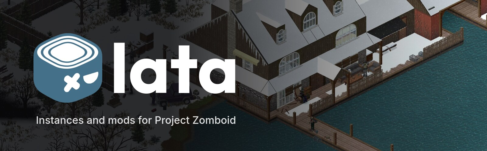
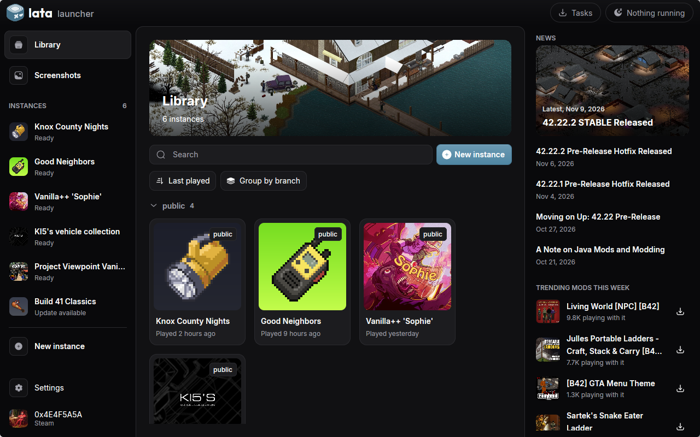
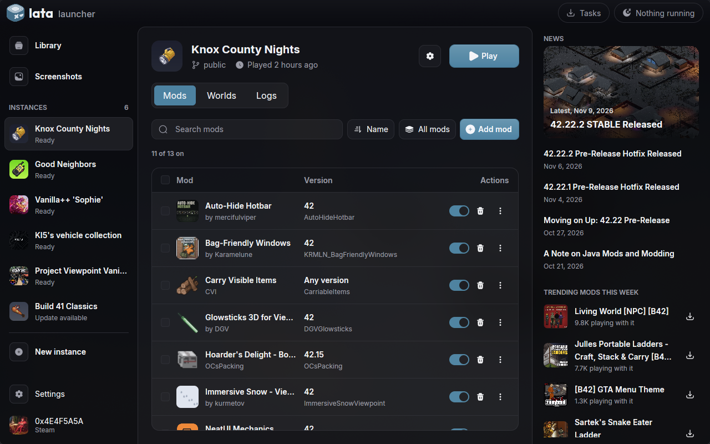

[](https://discord.gg/jeGPaMkDbU)
[](https://github.com/valentin-marquez/lata/actions/workflows/ci.yml)
[](LICENSE)

Instance launcher for Project Zomboid, rewritten from scratch in Rust.

> Work in progress. Not usable yet.

Each instance is its own install: game version (Steam branch), mods and saves. lata talks to Steam
natively, no SteamCMD.



## What it does

- Several installs side by side, each on its own Steam branch.
- Mods per instance: add, turn on or off, remove.
- Workshop mods and whole collections installed from a link, with the
  [lata link](extension) browser extension.
- Worlds and live game logs for each instance.
- Light and dark themes.

| | |
|---|---|
|  |  |
|  | |

## lata link

The browser extension adds an "Install in lata" button to Workshop pages.

[](https://chromewebstore.google.com/detail/fopkfokkcmmhgjjdlbjjmdgkffddjbpm)
[](https://addons.mozilla.org/firefox/addon/lata-link/)

## Community

Questions, feedback and news are on [Discord](https://discord.gg/jeGPaMkDbU).

## Build

```sh
cargo run -p lata
```

## Credits

Icons: [Solar](https://www.figma.com/community/file/1166831539721848736) by 480 Design,
[CC BY 4.0](https://creativecommons.org/licenses/by/4.0/).

Banner background: a screenshot of [Project Zomboid](https://projectzomboid.com) by The Indie Stone,
from its Steam store page. lata is a fan project, not affiliated with The Indie Stone.

## License

The code is under the [GNU General Public License v3](LICENSE). The lata name and logo, and the
Project Zomboid material, are not: see [COPYING.md](COPYING.md).
